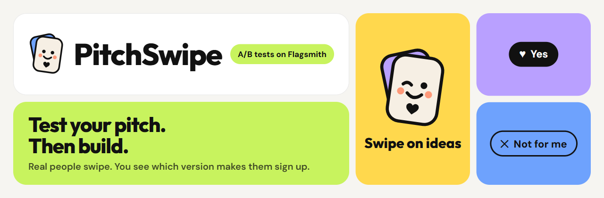
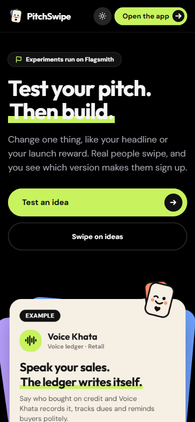
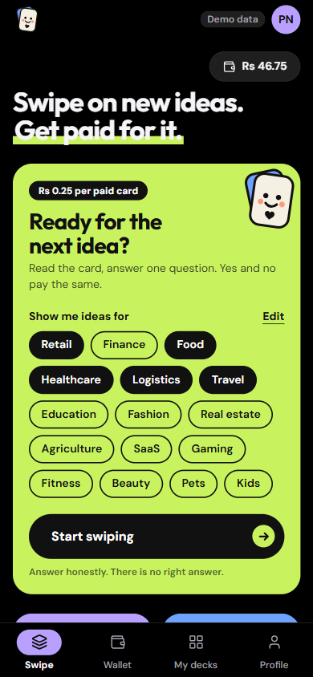
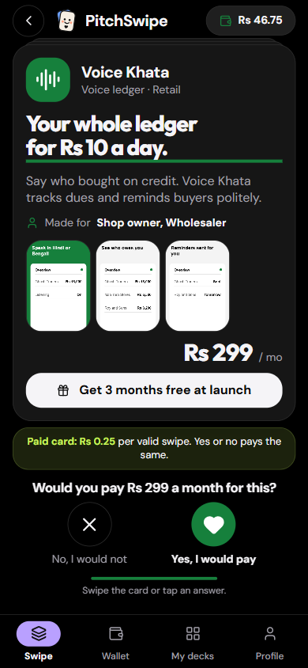
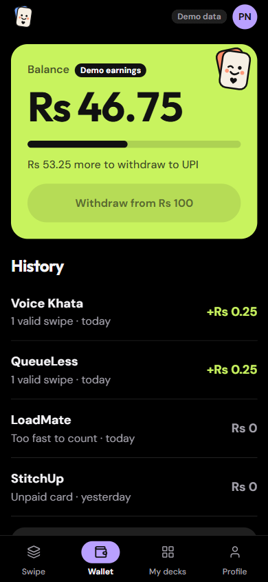
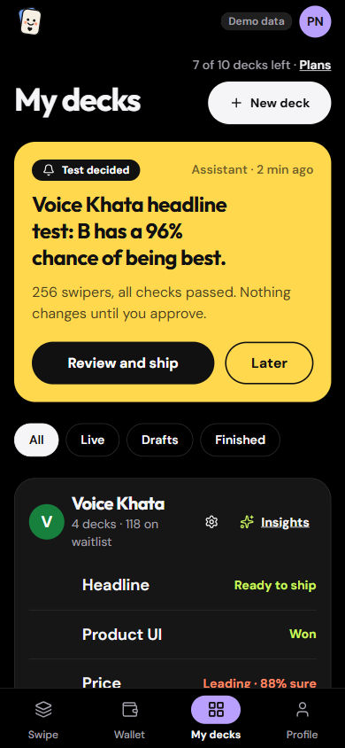
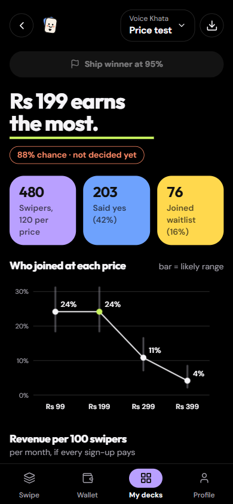

<p>
  <picture>
    <source media="(prefers-color-scheme: dark)" srcset="docs/images/banner-dark.png">
    
  </picture>
</p>

PitchSwipe lets founders A/B test their pitch before they build. Change one thing on a pitch card, like the
headline, the price or the launch reward, and real people swipe on it. Each person sees one version, Flagsmith
decides which version wins, and the people who liked it join your waitlist. Swipers see new ideas first and earn
a little for every honest answer.

[](https://noor-api.centralindia.cloudapp.azure.com)
[](https://github.com/swrno/PitchSwipe-main/releases/latest)
[](https://github.com/swrno/PitchSwipe-main/actions/workflows/deploy.yml)
[](#download)

## Download

<a href="https://github.com/swrno/PitchSwipe-main/releases/latest"></a>

**Web:** open **[noor-api.centralindia.cloudapp.azure.com](https://noor-api.centralindia.cloudapp.azure.com)**
in any browser. On a phone you can add it to your home screen; it installs as an app.

**Android:** download the APK from the **[latest release](https://github.com/swrno/PitchSwipe-main/releases/latest)**,
listed under Assets. On a computer, scan the code with your phone to open the release there. To install, open the
APK on your phone and allow your browser or file manager to install unknown apps when Android asks. The app needs
Android 7.0 or newer and an internet connection: it opens the live site inside a native shell.

**iOS:** each release includes a Simulator build and an unsigned device build. An iPhone only installs the
device build after it is signed with an Apple Developer certificate, which this project does not have yet. Until
then, use the web app on iPhone.

## Screenshots

<p>
  
  
  <br>
  
  
  
</p>

The screenshots show demo data, which the app labels as such.

## Features

### For founders

- Test one thing at a time: headline, description, launch reward, price, product UI, logo or language.
  Everything else stays locked and identical on every card, so you know what made the difference.
- Write 2 or 3 versions yourself, or draft them with AI (Claude). Code checks every draft: drafted copy may not
  invent figures, and translations must keep every figure unchanged.
- Each swiper sees exactly one version, assigned at random, so there is no order bias.
- People who like a version claim your launch reward with their email and join your waitlist. The version that
  earns the most claims wins.
- A winner is called only with at least 50 people per card and a 95% chance to beat the control, and nothing
  ships until you approve it.
- Results per price with likely ranges, who swiped (state, role, interests, only in groups of 10 or more), an
  assistant you can ask about your results, and insights across all your decks.
- Share a personal link or a QR code; the feed sends everyone else.

### For swipers

- See new ideas before they launch. Read a card, answer one question, and claim early rewards from founders you
  like.
- Paid cards are clearly marked: Rs 0.25 for every valid swipe, meaning you read the card for at least 2
  seconds. A yes and a no pay the same, so the only thing that pays is honesty. Earnings are demo earnings for
  now: no real money moves yet.
- A short practice round and simple quality checks keep the answers honest. A low score never locks you out; it
  only stops your swipes counting until it recovers.
- Swipe the card with your thumb or tap the buttons, with haptics on supported phones.
- Leave a comment by typing, or say it out loud in English or one of ten Indian languages (Chrome, Edge or
  Safari). Your browser turns speech into text, and Claude translates it to English for the founder. You check
  both before sending.

### The app

- Dark and light themes, chosen on the device and remembered.
- Works as a website, an installable web app, and an Android app.
- Email and password sign-in (Firebase Authentication) with email verification and password reset. Delete your
  account and your data from Profile at any time.

## Privacy

- Founders only ever see totals and groups of 10 or more people, never who answered.
- Accounts use Firebase Authentication; everything else is stored in our own MongoDB database on the server.
- Voice notes (signed in, verified email) are turned into text by your browser's own speech service. Only the
  text is sent to us (and to Anthropic for the English translation). The audio is uploaded only if you let the founder play it, and is
  deleted after 30 days by a daily job; the text stays.
- Deleting your account deletes your profile, wallet and reward claims, and anonymises your answers on other
  founders' decks so their results stay correct.
- The [privacy notice](https://noor-api.centralindia.cloudapp.azure.com/privacy) and
  [terms](https://noor-api.centralindia.cloudapp.azure.com/terms) are drafts that have not been legally reviewed.

## Status

PitchSwipe was built for the Flagsmith Toggle Wars hackathon. It runs in production on one Azure VM with real
accounts and a real database.

### Known limitations

- Swiper earnings are demo earnings. Withdrawals to UPI and paid plans are shown but not available.
- Without Flagsmith keys, versions are assigned by the app itself rather than by a Flagsmith experiment.
- AI drafting and the English translation of voice notes need a Claude API key; email needs a Resend key.
  Without a key, that feature says so (a voice note asks the swiper to type the English) and the rest of the app
  works.
- The Android app is a debug build that opens the live site. A release-signed build for the Play Store is not
  set up yet. Voice notes are not in the Android or iOS app yet (the app's WebView has no speech recognizer); the
  app asks the swiper to type the comment.
- The iOS app is compiled but not signed, so it cannot be installed on an iPhone yet.
- The terms and privacy notice need a legal review, and the support contact is not published yet.

### Ideas for later

- Create the Flagsmith experiment automatically when a deck is published.
- Real payouts for swipers, and paid deck packs.
- Signed Android and iOS releases in the stores.

## How it works

- **Web app:** Next.js 16 (App Router), React 19 and Tailwind CSS 4, served by `next start` behind nginx on an
  Azure VM (Ubuntu 22.04), with HTTPS from Let's Encrypt.
- **Accounts:** Firebase Authentication in the browser; API routes verify the ID token with the Firebase Admin
  SDK.
- **Data:** MongoDB 7 on the same VM (localhost only, authentication on, nightly backups), through Mongoose.
- **Experiments:** Flagsmith decides the winner: at least 50 identities per card, a 95% chance, and no
  sample-ratio mismatch.
- **AI:** Claude through the official Anthropic SDK for drafting, the results assistant and insight wording.
  Every number in AI text comes from code and is checked against the source data.
- **Mobile:** a Capacitor 8 shell for Android and iOS that loads the live site, with native haptics and
  edge-to-edge status bars.
- **Deploys:** every push to `main` runs CI. When it passes, GitHub Actions builds the app, installs it on the VM,
  health-checks it and rolls back automatically if the check fails ([deploy/vm/README.md](deploy/vm/README.md)).

More detail is in [docs/ARCHITECTURE.md](docs/ARCHITECTURE.md), and the product spec and designs are in
[`goal/`](goal/README.md).

## Build from source

You need Node.js 22 or newer and npm.

```bash
npm install
cp .env.example .env.local   # fill in values; without them the app runs on labelled demo data
npm run dev                  # http://localhost:3000
```

Other scripts:

```bash
npm run build          # production build
npm run start          # serve the production build
npm run lint           # ESLint
npm run typecheck      # tsc --noEmit
npm test               # all test suites
npm run doctor         # read-only check of every configured service
npm run db:sync-indexes -- --yes   # create the MongoDB indexes (once per database)
```

**Environment.** Every variable is listed and explained in [.env.example](.env.example). Server secrets stay on
the server; the only values the browser sees are the public Firebase web config and the Flagsmith client key.
With `PITCHSWIPE_DEMO=1` the app runs on fixture data, labelled "Demo data".

**Android.** With the Android SDK and a JDK installed:

```bash
CAP_SERVER_URL=https://noor-api.centralindia.cloudapp.azure.com npx cap sync android
cd android && ./gradlew assembleDebug    # android/app/build/outputs/apk/debug/app-debug.apk
```

**iOS.** No Mac is needed: the **iOS build** workflow compiles the app on a GitHub macOS runner. Run it from the
Actions tab, or push a tag like `ios-v0.1.0`. [docs/mobile.md](docs/mobile.md) covers both platforms.

## Releases

Each release on the [releases page](https://github.com/swrno/PitchSwipe-main/releases) has the Android APK, the iOS
Simulator build and the unsigned iOS device build. Release notes are in [docs/releases](docs/releases).

## Licence

No licence has been chosen yet, so all rights are reserved by the authors.
